<!-- ═══════════════ HEADER ═══════════════ -->

  

  

  

  
  
  

  
  
  

 

<!-- ═══════════════ ABOUT ═══════════════ -->
## 🌌 About Me

I'm a **Full Stack Developer** who enjoys turning ideas into fast, accessible and maintainable web products. I care about the whole journey, from a pixel-perfect interface to a well-structured API and a database that scales.

|  |  |
|---|---|
| 🎨 **Frontend** | Responsive, user-friendly interfaces with React, Next.js and Tailwind |
| ⚙️ **Backend** | REST APIs and database-driven apps with NestJS, Express and Laravel |
| 🗄️ **Data** | Relational and NoSQL design with PostgreSQL, MySQL and MongoDB |
| 🐳 **USE** | Docker, Git workflows and deployment to Vercel and Render|
| 🎯 **Goal** | Build useful, reliable and maintainable software |

 

<!-- ═══════════════ TECH STACK ═══════════════ -->
## 🪐 Tech Stack

<table align="center">
  <tr>
    <td align="center" width="140"><b>🎨 Frontend</b></td>
    <td>
      
    </td>
  </tr>
  <tr>
    <td align="center"><b>⚡ Backend</b></td>
    <td>
      
    </td>
  </tr>
  <tr>
    <td align="center"><b>🗄️ Databases</b></td>
    <td>
      
    </td>
  </tr>
  <tr>
    <td align="center"><b>🐳Tools</b></td>
    <td>
      
    </td>
  </tr>
  <tr>
    <td align="center"><b>🌱 Learning</b></td>
    <td>
      
    </td>
  </tr>
</table>

<b>📖 What I do with each technology</b>

 

- **React & Next.js**: reusable components, file-based routing and API integration
- **TypeScript**: typed, safer and more maintainable code across the stack
- **Tailwind CSS & Vite**: fast, modern, responsive styling and tooling
- **NestJS**: modular backends with controllers, services and dependency injection
- **Express & Node.js**: REST APIs and middleware
- **Laravel & PHP**: structured web apps and REST APIs
- **MongoDB / PostgreSQL / MySQL**: schema design, queries, Mongoose and SQL
- **Docker**: containerized apps and consistent dev environments
- **Postman**: testing and debugging APIs

 

<!-- ═══════════════ PROJECTS ═══════════════ -->
## 🚀 Featured Projects

<table>
  <tr>
    <td width="50%" valign="top">

### 🛍️ E-commerce Shop
Browse products and manage online shopping end to end.

- Product listings and detail pages
- Cart and checkout workflow
- Categories and brands
- Responsive UI with backend API integration

</td>
    <td width="50%" valign="top">

### ⚡ NestJS REST API
Backend for managing e-commerce data and business logic.

- Products, brands and categories
- Authentication and user management
- Carts and orders
- Clean, modular REST architecture

</td>
  </tr>
  <tr>
    <td width="50%" valign="top">

### 🏫 School Management System
Organize school information and academic activities.

- Teacher and student management
- Classes and courses
- Attendance tracking
- Student score management

</td>
    <td width="50%" valign="top">

### 📦 Inventory Management System
Track products and stock with an admin dashboard.

- Product and inventory management
- Stock monitoring
- Supplier and purchase workflows
- Administrative dashboard

</td>
  </tr>
</table>

  

 

<!-- 

  

 -->

 

<!-- ═══════════════ CONNECT ═══════════════ -->
## 🤝 Let's Connect

  Have an idea, a project, or just want to talk code? I'd love to hear from you.

  
  

  

<i>"Keep learning, keep building, and keep reaching for the stars." 🌌</i>

  

